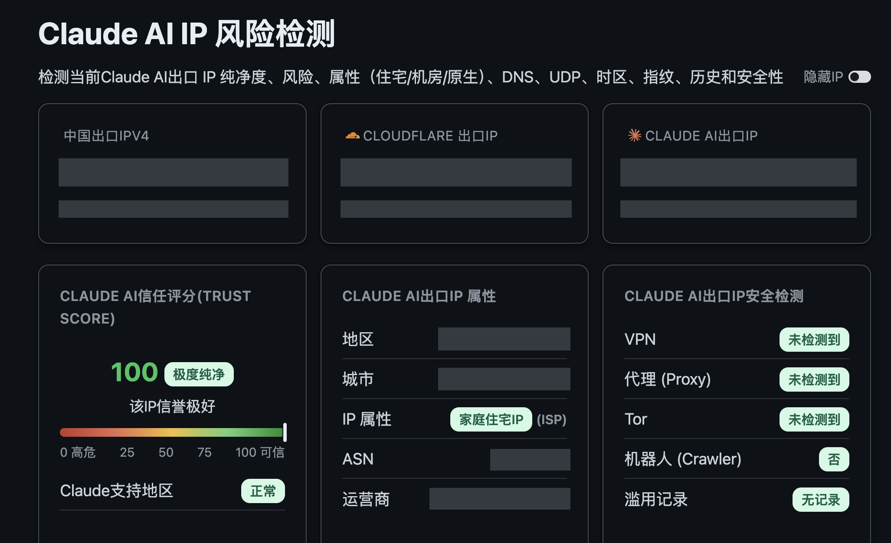
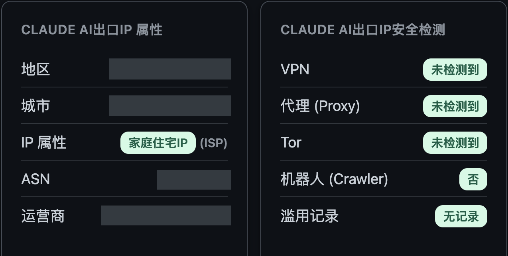

# CC Anti-Ban | Claude Account First-Aid Kit

**Claude account banned? What can you do next?**

A guided checklist, evidence organizer and appeal-draft workflow, with a local macOS Claude Code environment tool. It helps you work through the problem; it does not lift account suspensions or claim to have cracked official risk controls.

[中文](README.md) · [Self-check guide](references/self-check.md) · [Install](INSTALL.md) · [For AI Agents](#for-ai-agents) · [Reference pages](#reference-pages)

## Choose the right path

| What you see | Where to start |
| --- | --- |
| Connection, proxy, installation or authentication errors | Review relevant environment and client evidence; a 403 alone does not establish a ban |
| Billing, identity verification, subscription or usage prompts | Check the official page yourself; the Agent organizes a redacted summary |
| An explicit suspension notice | Build a timeline and prepare material for the [official appeal process](https://support.claude.com/en/articles/8241253-safeguards-warnings-and-appeals) |
| Missing or conflicting information | Preserve uncertainty and ask only for details that change the next step |

The [self-check guide](references/self-check.md) covers seven categories when relevant: error type, client/authentication, actual region/eligibility, recent changes, startup proxy, billing/KYC/subscription/usage, and next action. It is not a mandatory questionnaire.

Agent notes distinguish user-reported information, tool observations, unconfirmed items and items that do not apply. A user's confirmation is not automatically official verification. Third-party reports remain separate sources; no account-risk score is generated or added to the CLI report.

The checklist separates official guidance, tool observations, user-reported information and unverified community experience. It does not turn anecdotes into account-scoring rules or treat ordinary same-city network changes as proof of a ban. See [sources and limitations](references/self-check-sources.md). Guides and the local UI are currently Chinese; this page is the English entry.

## For AI Agents

Use **Codex**, **Kimi Code**, or another independent Coding Agent with local file and terminal tools, including agents using **DeepSeek** models. **Claude is the subject of inspection.**

```text
Install “CC Anti-Ban | Claude Account First-Aid Kit” from:
https://github.com/TIANTIAN-ZHAN/cc-anti-ban-skill

Read INSTALL.md and SKILL.md in the full repository. Check prerequisites,
build with scripts/build-safe.zsh, and run --help only after this build succeeds.
Preserve existing directories. Report missing access or dependencies.
Install the standalone tool only; do not install an Agent Skill automatically.
Do not start a questionnaire, real inspection, serve, network probe or Claude,
read account material, or change system settings during installation.
Report the repository/binary paths and build/help results, then wait for my next step.
```

**[INSTALL.md → authoritative commands and optional Codex Skill](INSTALL.md)**

After installation, you can ask: “Use the self-check guide to organize the redacted information I have provided. Ask only for relevant gaps and give evidence status and next steps. Start with written analysis, without inspecting my machine, opening testing sites or submitting an appeal.”

Installation stops at build and help. Appeals remain drafts unless sending/submission was explicitly authorized; identity verification and payments are handled by the user on official pages. Do not install this diagnostic Skill into `.claude/skills` or rely on Claude to inspect itself. Full client compatibility has not been verified end to end.

## Reference pages

The first two images are views of **one user-provided Net.Coffee screenshot, with identifying information redacted**; the second is a detail crop. Values retain the original screenshot's display and were not retested by this project. They do not demonstrate this tool's effects or determine an Anthropic account's status. The third item uses a text preview. Thanks to Net.Coffee for the interface and information-design references; its scoring service is not integrated here.

### 01 · Claude AI IP risk check

<a href="https://ip.net.coffee/claude/"></a>

User-provided screenshot, redacted. The original framing is preserved; the source did not include the complete webpage.

[Open the Claude reference →](https://ip.net.coffee/claude/) · Third-party page; opening it may start checks.

A reference for how the site organizes environment signals, not an Anthropic account-status determination.

### 02 · Same-image detail: IP attributes and security checks

<a href="https://ip.net.coffee/claude/"></a>

A crop of the two lower cards in the same screenshot, not another measurement. [Screenshot source →](https://ip.net.coffee/claude/) · [IP reference (separate page) →](https://ip.net.coffee/ip/). Opening third-party pages may start checks.

Network labels cannot establish a person's actual location or service eligibility.

### 03 · Claude Code environment notes

> **[Net.Coffee · Claude Code reference →](https://ip.net.coffee/claude/claudecode.html)**
>
> Third-party topics: IP, DNS, IPv6 and traffic routing for the Claude Code environment. Read alongside the other references; use [official Claude Code documentation](https://code.claude.com/docs/en/network-config) for applicable configuration.

Third-party pages may automatically collect IP/DNS/WebRTC/device information. Viewing the local redacted images or reading a guide does not authorize running those checks. Only the redacted derivatives authorized by the user are stored here; see [NOTICE](NOTICE.md) for attribution and rights boundaries.

## The included local tool

`cc-health` reviews installation, basic configuration and startup proxy selection on macOS. Separate consent enables one limited reference probe or a loopback HTTP proxy plan for a supported new Claude process. No active outbound probe occurs by default; the system proxy, original shell and configuration files remain unchanged.

The existing score describes limited reference evidence and coverage. The CLI account field remains unknown with no passing weight. Guided notes do not modify the Report. [Report contract](references/report-contract.md) · [Install](INSTALL.md)

Requires Go 1.25+, clang/SDK and a trusted, already-running zsh. Tested on macOS 27 arm64; older macOS, Intel and full official CLI compatibility are unverified. No prebuilt packages are provided. Local inspection may read credentials in environment/configuration data into memory; raw contents are not sent externally, logged or exported, and immediate erasure is not promised. [Privacy and consent](references/safety-and-privacy.md)

## Feedback

[Share a redacted issue](https://github.com/TIANTIAN-ZHAN/cc-anti-ban-skill/issues) with symptoms, reproduction steps and unknowns. Do not share account details, email addresses, tokens, identity documents, raw configuration or credential-bearing links.

Independent project, not affiliated with Anthropic. No unban or anti-ban guarantee. The canonical repository/Skill remains `cc-anti-ban-skill`; the command is `cc-health`. [MIT License](LICENSE) · [Notices](NOTICE.md) · [Validation](references/validation.md)
