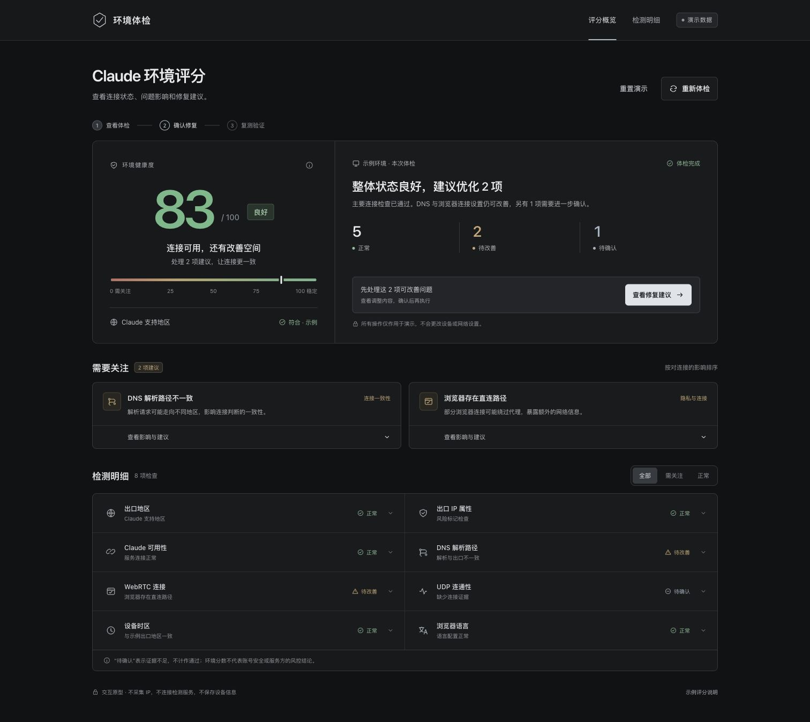

# cc-anti-ban-skill

用于 Claude 环境审查、确认修复与复测的 Skill 项目。

> **当前是初始化版本。仅包含工作流规范和离线交互演示；真实探测、真实评分、真实修复与复测尚未实现。项目名称不代表能够保证账号不被封禁。**

## 想解决什么

把环境问题整理成一个可理解、可确认的流程：

**审查 → 一个总分 → 问题及影响 → 一次确认修复清单 → 同条件复测。**

先解释证据和影响，再由用户决定是否调整。证据不足的项目保留未知；不通过换国家、清 Cookie 或批量改配置“刷分”。我们不知道 Net.Coffee 的完整权重或站方算法，不宣称复刻其评分。

## 目前可用

| 内容 | 状态 |
| --- | --- |
| 标准 Skill 入口、隐私边界、报告约定 | 已初始化，可审阅用户提供的脱敏证据 |
| 本地评分界面与确认/取消/复测流程 | 可交互演示，全部为样例数据 |
| 自动读取系统、浏览器或代理配置 | 未实现 |
| 真实网络探测、评分引擎、修复及回滚适配器 | 未实现 |
| 真实环境报告 | 不生成数值评分；总分为 `null` / “未评分” |

直接用现代浏览器打开 [demo/index.html](demo/index.html)，无需安装依赖或联网。演示起始 83 分，确认两项模拟调整后复测为 95 分，UDP 仍待确认。刷新即重置，不保存设备信息。

Skill 的标准入口在根目录 [SKILL.md](SKILL.md)，界面元数据在 `agents/openai.yaml`。本仓库初始化不会自动把 Skill 安装到个人环境，也不会启动后台任务。

## 范围与边界

- 当前运行面仅为本地浏览器演示；Claude Web、Claude Code、操作系统和代理客户端的真实支持矩阵尚待确定。
- 默认只读，只审阅用户主动提供的脱敏证据。当前没有第三方检测服务或外部数据源。
- 不抓取 Cookie、token、Keychain、订阅、账号或聊天；不将真实 IP、设备快照和配置备份提交到仓库。
- 未来真实修改需先提供具体清单、备份/回滚办法和验证标准，用户确认后才能执行。
- 分数描述环境证据，不等于账号安全、服务成功率或平台风控结论。

详见 [隐私与操作边界](references/safety-and-privacy.md) 和 [报告约定](references/report-contract.md)。

## 下一步

1. 明确首批平台、功能场景与允许检查的数据范围。
2. 实现可脱敏、默认只读的证据适配器，保留来源、时间和未知状态。
3. 选择有明确用途与授权边界的检测项；任何真实外联需单独说明。
4. 定义并验证独立的版本化评分策略、覆盖率和未知项规则，不冒充站方算法。
5. 加入逐项可回滚的修复适配器和同条件复测，补齐离线回归与受控环境验证。

## English

**Initialization only: no live probes, production scoring engine, real repair adapters, or real retest implementation exist yet.**

This repository defines a Claude environment-review skill and an offline UI prototype. The intended workflow is review → one score → issues and impact → one confirmation of a concrete repair plan → retest under comparable conditions.

Open `demo/index.html` in a modern browser. Its sample score changes from 83 to 95 after two simulated repairs and a simulated retest; UDP remains unknown. All state is held in the page's memory. No environment data is collected and no detection service is contacted.

The initial skill may review redacted evidence supplied by the user, but must report a real-environment score as `null` / unscored. Sample weights are not Net.Coffee's or Claude's official algorithm. The repository name is not a guarantee against account suspension or a platform-evasion claim.

Platform and provider support remain undecided. Future real changes require a concrete approved plan, backup, rollback and verification. Never collect credentials, cookies, private account/subscription/chat data or personal machine evidence into this repository.

No open-source license has been selected. This repository is private; decide licensing and redistribution terms before any public release.

尚未选择开源许可证；公开前需确认授权和分发范围。
