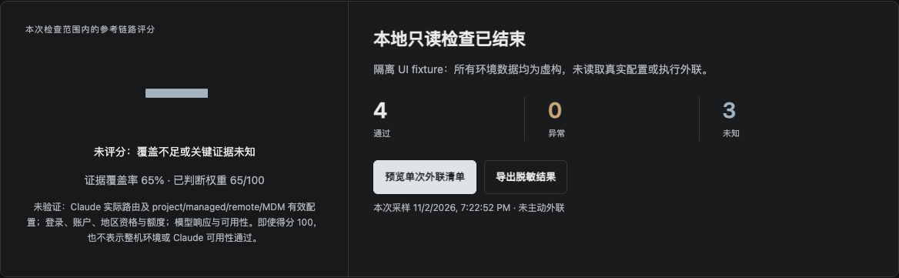

<p align="center">
  
</p>

<p align="center">
  <strong>面向 macOS 的 Claude Code 环境诊断工具</strong><br>
  把安装、配置、代理与参考链路放到同一页，看清哪些已通过、哪些异常、哪些还不知道。
</p>

<p align="center">
  <a href="#for-ai-agents">交给 Agent 安装</a> ·
  <a href="INSTALL.md">手动安装</a> ·
  <a href="#当前界面">查看界面</a> ·
  <a href="README.en.md">English</a>
</p>

<p align="center">macOS · 本地优先 · 按次确认 · MIT</p>

## 把“连不上”拆成看得见的问题

Claude Code 出现问题时，安装、代理和配置往往混在一起。**Claude 环境证据**先整理当前启动环境，再由你决定是否进行一次网络参考探测，或为一个新 Claude 会话应用临时代理。

| 你想弄清楚的事 | 工具能给你的证据 |
| --- | --- |
| Claude 装在哪里，版本能否读取？ | PATH 定位与受限沙箱中的版本检查 |
| 配置和代理是否存在冲突？ | 基础 JSON/env 校验、启动代理选择与已观察冲突 |
| 一次参考连接卡在哪一层？ | 用户确认后的 DNS、TCP/CONNECT、TLS、HTTP 分层结果 |
| 这些结果能说明多少？ | 可解释评分、证据覆盖率，以及明确保留的未知项 |
| 想试一个本机代理，又不改原环境？ | 为受支持的新 Claude 进程应用回环 HTTP 代理，单独预览并确认 |

**默认无主动外联。** 本地检查、一次网络探测和新会话启动分别确认；不修改系统代理、原 shell 或配置文件。工具可独立启动，不需要 Claude 先能正常工作。

## For AI Agents

### 复制这段，交给你的 Coding Agent

适用于 **Codex、Kimi Code**，或使用 **DeepSeek 等模型**且具备本地文件与终端工具的其他 Coding Agent。Claude Code 是被检查对象，安装和诊断交给独立 Agent。

```text
帮我安装「Claude 环境证据」：
https://github.com/TIANTIAN-ZHAN/cc-anti-ban-skill

先阅读完整仓库中的 INSTALL.md 和 SKILL.md，按 INSTALL.md 检查依赖、
使用 scripts/build-safe.zsh 构建，只在本次构建成功后运行 --help 验收。
保留完整仓库，不覆盖已有目录；遇到仓库权限或依赖缺失，说明阻塞。
先安装独立工具，不自动安装到任何 Agent 的 Skill 目录。
不要运行真实检查、serve、网络探测、Claude 或模型调用，不修改系统设置。
完成后告诉我仓库与二进制路径、构建及 --help 结果，再等我选择项目并授权检查。
```

**[INSTALL.md → 权威安装步骤与可选 Codex Skill](INSTALL.md)**

安装验收只需成功构建并显示帮助。无需将诊断 Skill 装进 Claude，也无需 Claude 自检。各 Agent 的客户端加载与完整使用流程尚未做端到端兼容验收。

## 当前界面

**当前界面 · 模拟数据** — 下图直接截取本仓库当前 UI 的隔离测试页面；数据为虚构，未读取真实配置或进行真实外联。未执行的参考探测保持“未知”，不会补出一个漂亮分数。



当前 UI 使用“Claude 环境证据”作为展示名；仓库和 Skill 的名称仍为 `cc-anti-ban-skill`，命令为 `cc-health`。

## 三步开始

1. **安装工具。** 让 Agent 执行上方请求，或按 [INSTALL.md](INSTALL.md) 手动构建并运行 `--help`。
2. **选择项目。** 授权后从目标项目启动本机界面，阅读告知，再开始本地检查。
3. **按证据决定。** 查看明细、导出脱敏结果；需要时再确认一次参考探测或新会话代理计划。

你随时可以停在本地检查这一步。网络探测不会登录或调用模型；新 Claude 会话有自己的网络、文件和 hooks 行为，需另行确认。

## 使用前了解这些边界

- **本地数据：** 检查会读取完整进程环境与固定用户配置原文，可能含凭据并进入本地内存；原文不发往外部服务、写日志或导出。不承诺立即擦除内存。[隐私与授权范围](references/safety-and-privacy.md)
- **分数含义：** 评分仅描述限定的环境与参考链路。账号、地区资格、额度、模型及 Claude 最终实际路由始终保留未知；覆盖不足时不显示数字。[评分与报告契约](references/report-contract.md)
- **运行范围：** 需要 Go 1.25+、clang/SDK 与可信已运行 zsh。实际验证为 macOS 27 arm64；最低构建目标 13.0 不等于旧系统或 Intel 已通过。当前无预编译包，官方 Claude 完整兼容性未实证。[安装与支持](INSTALL.md)

## 文档与项目

[安装指南](INSTALL.md) · [Agent 操作说明](SKILL.md) · [隔离验证](references/validation.md) · [English](README.en.md)

另有 [早期静态交互原型](demo/index.html) 可离线打开；其中 83→95、地区/IP/WebRTC 等是原型示例，不是当前工具的实测结果或功能承诺。

本项目独立开发，非 Anthropic 官方产品。仓库名中的 “anti-ban” 不代表防封、恢复账户或可用性保证。采用 [MIT License](LICENSE)，名称和素材说明见 [NOTICE](NOTICE.md)。
