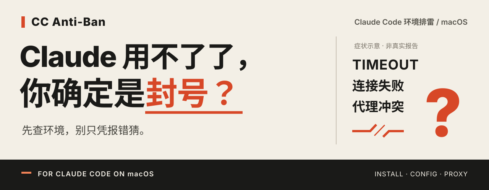

<p align="center">
  
</p>

<p align="center">
  <strong>CC Anti-Ban · 先排环境，再下结论。</strong><br>
  面向 macOS 的 Claude Code 环境排雷工具。Claude 不工作，也能开始排查。
</p>

<p align="center">
  <a href="#for-ai-agents">交给 Agent 安装</a> ·
  <a href="INSTALL.md">手动安装</a> ·
  <a href="#在线检测参考">在线检测参考</a> ·
  <a href="#聊聊你的报错">聊聊你的报错</a> ·
  <a href="README.en.md">English</a>
</p>

<p align="center">macOS · 本地优先 · 按次确认 · MIT</p>

## 用不了，就一定是封号？

Claude Code 突然用不了：请求超时、连接失败，代理切来切去还是不行。你可能已经开始怀疑账号，但这些现象本身还不能告诉你原因。

**CC Anti-Ban** 从能验证的地方开始：查安装、基础配置和启动代理；需要时，再确认一次限定的网络参考探测。把通过、异常和未知摊开看，决定下一步怎么做。

**已经明确收到账号停用通知？** 请走 [官方申诉](https://support.claude.com/en/articles/8241253-safeguards-warnings-and-appeals)。本工具不判断账号是否停用，也不能恢复被停用的账号。

| 先查哪里 | 你能得到什么 |
| --- | --- |
| 安装与配置 | 找到 Claude CLI、检查版本与基础 JSON/env 结构，定位已观察到的冲突 |
| 代理与参考链路 | 看清启动代理选择；确认后查看一次 DNS、TCP/CONNECT、TLS、HTTP 分层结果 |
| 结果可信到哪一步 | 参考评分与证据覆盖率一起展示；证据不足就保留未知 |
| 想试一个本机代理 | 预览计划，为受支持的新 Claude 进程应用回环 HTTP 代理，原环境不变 |

报错要结合上下文看：例如 `403` 也可能涉及模型或资源访问权限，不能只凭状态码判定封号。参见 [Claude Code 官方排障](https://support.claude.com/en/articles/14552646-troubleshoot-claude-code-installation-and-authentication) 与 [API 错误说明](https://platform.claude.com/docs/en/api/errors)。

**默认无主动外联。** 本地检查、一次网络探测和新会话启动分别确认；不修改系统代理、原 shell 或配置文件。你可以先停在本地检查这一步。

## For AI Agents

### 复制这段，交给你的 Coding Agent

适用于 **Codex、Kimi Code**，或使用 **DeepSeek 等模型**且具备本地文件与终端工具的其他 Coding Agent。Claude Code 是被检查对象，安装和诊断交给独立 Agent。

```text
帮我安装「CC Anti-Ban」：
https://github.com/TIANTIAN-ZHAN/cc-anti-ban-skill

先阅读完整仓库中的 INSTALL.md 和 SKILL.md，按 INSTALL.md 检查依赖、
使用 scripts/build-safe.zsh 构建，只在本次构建成功后运行 --help 验收。
保留完整仓库，不覆盖已有目录；遇到仓库权限或依赖缺失，说明阻塞。
先安装独立工具，不自动安装到任何 Agent 的 Skill 目录。
不要运行真实检查、serve、网络探测、Claude 或模型调用，不修改系统设置。
完成后告诉我仓库与二进制路径、构建及 --help 结果，再等我选择项目并授权检查。
```

**[INSTALL.md → 权威安装步骤与可选 Codex Skill](INSTALL.md)**

安装验收只需成功构建并显示帮助。无需将诊断 Skill 装进 Claude，也无需 Claude 自检。各 Agent 的客户端加载与完整使用流程尚未做端到端兼容验收。

## 在线检测参考

> **[Net.Coffee · Claude AI IP 风险检测 →](https://ip.net.coffee/claude/)**
>
> 感谢 Net.Coffee 为本项目早期评分演示提供界面参考。

该第三方站点与本项目独立；我们未接入其评分服务，检测结果不代表 Anthropic 对账号的判定。

## 三步开始

1. **安装工具。** 让 Agent 执行上方请求，或按 [INSTALL.md](INSTALL.md) 手动构建并运行 `--help`。
2. **选择项目。** 授权后从目标项目启动本机界面，阅读告知，再开始本地检查。
3. **按证据决定。** 查看明细、导出脱敏结果；需要时再确认一次参考探测或新会话代理计划。

你随时可以停在本地检查这一步。网络探测不会登录或调用模型；新 Claude 会话有自己的网络、文件和 hooks 行为，需另行确认。

## 使用前了解这些边界

- **本地数据：** 检查会读取完整进程环境与固定用户配置原文，可能含凭据并进入本地内存；原文不发往外部服务、写日志或导出。不承诺立即擦除内存。[隐私与授权范围](references/safety-and-privacy.md)
- **分数含义：** 评分仅描述限定的环境与参考链路。账号、地区资格、额度、模型及 Claude 最终实际路由始终保留未知；覆盖不足时不显示数字。[评分与报告契约](references/report-contract.md)
- **运行范围：** 需要 Go 1.25+、clang/SDK 与可信已运行 zsh。实际验证为 macOS 27 arm64；最低构建目标 13.0 不等于旧系统或 Intel 已通过。当前无预编译包，官方 Claude 完整兼容性未实证。[安装与支持](INSTALL.md)

## 聊聊你的报错

你遇到的是超时、连接失败，还是某个具体错误？[到 Issues 交流或反馈](https://github.com/TIANTIAN-ZHAN/cc-anti-ban-skill/issues)，分享错误现象、复现步骤，以及哪些环境证据通过、失败或仍未知。

只贴经过脱敏的片段；不要上传原始配置、完整环境变量、账号、邮箱、token 或含凭据的代理/订阅链接。反馈不需要这些信息。

## 文档与项目

[安装指南](INSTALL.md) · [Agent 操作说明](SKILL.md) · [隔离验证](references/validation.md) · [English](README.en.md)

另有 [早期静态交互原型](demo/index.html) 可离线打开；其中 83→95、地区/IP/WebRTC 等是原型示例，不是当前工具的实测结果或功能承诺。

本项目独立开发，非 Anthropic 官方产品。品牌与仓库名中的 “Anti-Ban” 不代表防封、恢复账户或可用性保证。采用 [MIT License](LICENSE)，名称和素材说明见 [NOTICE](NOTICE.md)。
